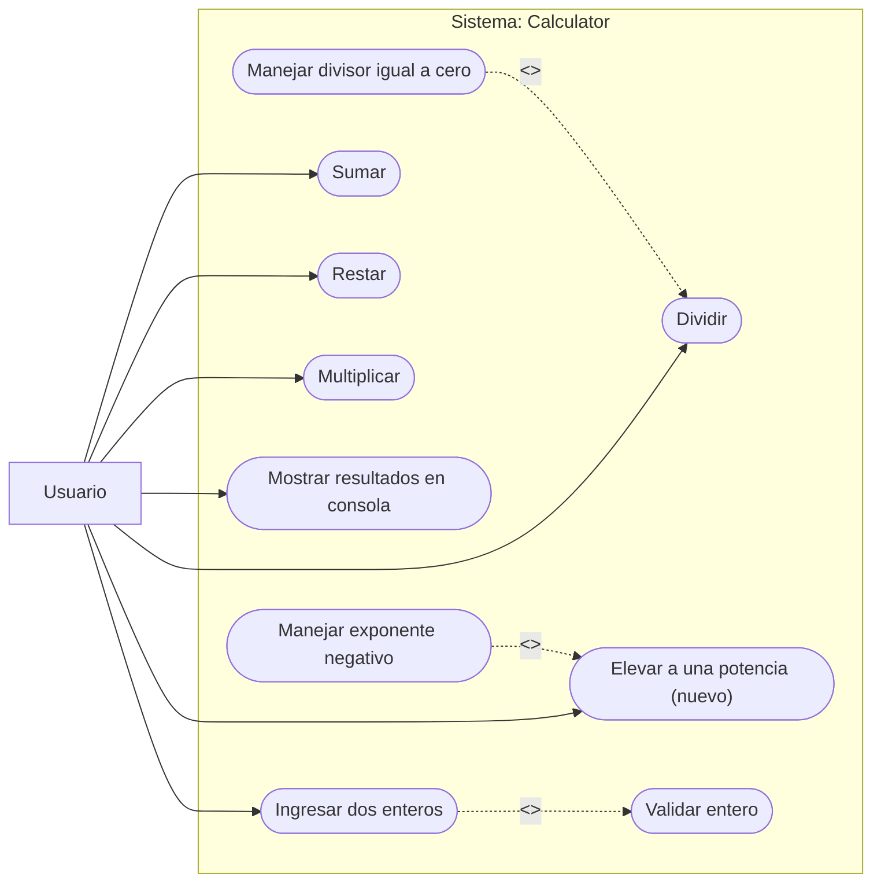

# Calculadora de operaciones aritméticas

Aplicación de consola en Java (`Calculator.java`, un solo archivo). Recibe dos enteros y calcula suma, resta, multiplicación, división y potencia.

## Ejecución

```
java Calculator.java          # calculadora
java Calculator.java test     # pruebas unitarias (30 tests)
```

Requiere Java 11 o superior.

## Requisitos (versión 1.1)

| Id | Requisito |
|----|-----------|
| RF1 | Leer dos valores enteros por consola. |
| RF2 | Calcular suma, resta, multiplicación y división, cada una en su propio método. |
| RF3 | Rechazar cualquier valor que no sea entero y volver a pedirlo con un mensaje de error. |
| RF4 | En la división, si el divisor es 0, no dividir y mostrar: *El divisor debe ser diferente de cero, escriba otro numero*. |
| RF5 | Mostrar los resultados por consola. |
| RF6 (cambio) | Calcular a elevado a b con un ciclo `for`. |

## Diagrama de casos de uso



**Actor:** Usuario (persona que ejecuta la aplicación en consola). El cliente es quien aprueba los requisitos, pero no interactúa con el sistema.

| Caso de uso | Descripción |
|-------------|-------------|
| Ingresar dos enteros | El usuario escribe `a` y `b`. Incluye *Validar entero*. |
| Sumar / Restar / Multiplicar | Calcula `a + b`, `a - b`, `a * b`. |
| Dividir | Calcula `a / b`. Extiende con *Manejar divisor igual a cero*. |
| Elevar a una potencia | Calcula `a ^ b` con un ciclo `for`. Extiende con *Manejar exponente negativo*. |
| Mostrar resultados | Escribe los resultados o mensajes de error en la consola. |

## Decisiones de diseño

- Suma, resta y multiplicación devuelven `long` para evitar desbordamiento de `int`.
- La división devuelve decimal (`7 / 2 = 3.5`).
- Potencia: el exponente negativo no se acepta (el resultado no sería entero) y si el resultado supera el rango de `long` se muestra un error.
- `0 ^ 0` se calcula como 1 (resultado natural del ciclo `for`).

## Pruebas unitarias

Los 30 tests (OPARIT001 a OPARIT030) están en `Calculator.java` y se ejecutan con `java Calculator.java test`. Resultado: **30 aprobados, 0 fallidos**. El detalle (entradas, resultado esperado, obtenido, fecha) está en `Tests_Unitarios_Calidad_para_Operaciones_aritmeticas.xlsx`. Responsable: William Cando.

| Componente | Tests |
|------------|-------|
| Suma | 001, 004–007 |
| Resta | 008–011 |
| Multiplicación | 012–016 |
| División | 002, 003, 017–020 |
| Lectura de enteros | 021–023 |
| Potencia | 024–030 |

## ISO/IEC 25010: dimensiones de calidad

**Vale la pena evaluar**

| Dimensión | Por qué |
|-----------|---------|
| Adecuación funcional | Es el propósito de la aplicación: que cada operación dé el resultado correcto. |
| Fiabilidad | Debe tolerar división por cero, entradas inválidas, exponente negativo y desbordamiento sin caerse. |
| Usabilidad | La consola debe indicar qué escribir y explicar los errores con claridad (protección contra errores del usuario). |
| Mantenibilidad | El cliente pidió un cambio; la modularidad (un método por operación) y la facilidad de prueba determinan qué tan barato fue. |
| Portabilidad (básica) | Solo verificar que corre en cualquier sistema con Java. |

**No vale la pena evaluar**

| Dimensión | Por qué |
|-----------|---------|
| Eficiencia de desempeño | Las operaciones son instantáneas; no hay carga ni recursos que medir. |
| Compatibilidad | No se integra ni comparte datos con otros sistemas. |
| Seguridad | No hay usuarios, autenticación, red ni datos sensibles. |

## Tests por dimensión

| Dimensión | Tests |
|-----------|-------|
| Adecuación funcional | Cada operación con positivos, negativos, cero, valores grandes y resultado decimal (OPARIT001–020, 024–028). Verificar que la potencia use el ciclo `for` y que `a^0 = 1`. |
| Fiabilidad | División por cero (003, 020), exponente negativo (029), desbordamiento (030), repetir 100 ejecuciones seguidas sin fallos. |
| Usabilidad | Texto, decimales y vacío en lugar de entero (021, 022): debe mostrar el mensaje y volver a pedir el dato. Revisar que los mensajes estén en español, sean claros y los indicadores (`a`, `b`) se entiendan. |
| Mantenibilidad | Revisar que cada operación esté en un método independiente y que agregar la potencia no haya modificado los demás métodos (pruebas de regresión 001–023 siguen aprobadas). |
| Portabilidad | Ejecutar en Windows, Linux y macOS con Java 11 y 21. |

## Gestión del cambio: quinta operación (potencia)

El requisito de potencia llegó con el documento de requisitos ya aprobado y el código probado. Es un **cambio de alcance** y no se implementa directamente: se gestiona con el cliente.

1. **Registrar** la solicitud como petición de cambio (quién la pide, fecha, descripción: *a^b con ciclo for*).
2. **Analizar el impacto** y comunicarlo al cliente:

| Elemento | Impacto |
|----------|---------|
| Requisitos | Nuevo RF6; el documento pasa de versión 1.0 a 1.1. |
| Código | Nuevo método `power` (ciclo `for`) y una línea nueva en la salida. |
| Diagrama UML | Nuevo caso de uso *Elevar a una potencia*. |
| Pruebas | 7 tests nuevos (024–030) y repetir los 23 anteriores como regresión. |
| Riesgos | Exponente negativo y desbordamiento: el cliente debe decidir cómo se tratan. |
| Esfuerzo y costo | Pequeño (un método y sus pruebas); se informa estimación de tiempo y costo adicional. |

3. **Preguntar al cliente** los casos no definidos: ¿se permite exponente negativo? ¿qué hacer si el resultado es muy grande? ¿`0^0`?
4. **Obtener aprobación por escrito** del cambio, su costo y el nuevo plazo.
5. **Implementar**, actualizar requisitos, UML y plan de pruebas.
6. **Ejecutar regresión completa** (30 tests) y entregar la versión 1.1 con el informe de resultados.
